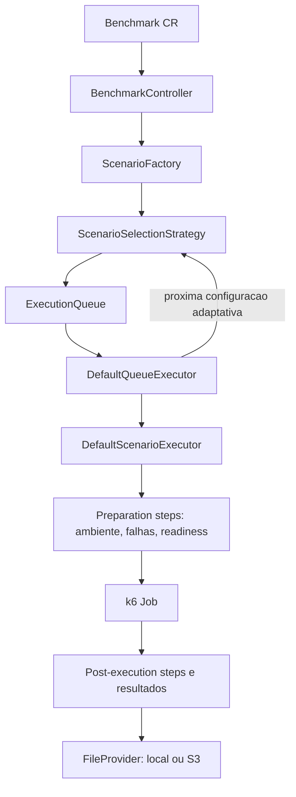

# Arquitetura

## Visao geral

O repositorio contem tres partes principais:

- **Operator** (`resilience-bench/operator`): aplicacao Java 17 com Spring e Java Operator SDK; observa CRDs e coordena a execucao.
- **Visualizer** (`resilience-bench/visualizer`): aplicacao Angular client-side que carrega arquivos JSON locais.
- **Manifests e exemplos** (`crd`, `samples`): definicoes de recursos e configuracoes de exemplo aplicaveis ao cluster.

## Fluxo de um benchmark

## Responsabilidades

- `BenchmarkController` reconcilia `Benchmark`, localiza o `Workload`, cria cenarios, seleciona a estrategia, prepara a fila e inicia a execucao.
- `ScenarioFactory` expande os templates do benchmark em cenarios concretos.
- `ScenarioSelectionStrategySelector` escolhe entre estrategias registradas. Estrategias adaptativas podem receber resultados agregados e selecionar configuracoes seguintes.
- `DefaultQueueExecutor` processa a fila, tenta replay pelo cache quando habilitado, atualiza estados e solicita novas configuracoes adaptativas.
- `DefaultScenarioExecutor` executa os passos de preparacao, cria o Job do k6 e encadeia os passos posteriores ao termino do Job.
- `StepRegistry` agrupa passos de preparacao e pos-execucao, incluindo integracoes com Kubernetes e Istio.
- `FileProvider` abstrai persistencia local ou S3; classes de `resultcache` organizam chaves, replay e traces.
- O Visualizer consome artefatos `trace.json` e `results.json` no navegador e nao conversa com o operador.

## Limites importantes

- `Scenario` e a unidade concreta executada. Estrategias de selecao podem decidir por configuracao de resiliencia, que pode expandir para varios cenarios de carga e falha.
- O operador depende de APIs e recursos disponiveis no cluster, incluindo recursos Istio quando os passos correspondentes forem usados.
- O Visualizer e independente do cluster; sua entrada sao arquivos JSON.

Para o significado dos recursos, consulte [modelo de dominio](domain-model.md). Para detalhes das estrategias, consulte [heuristicas de selecao](heuristicas-de-selecao.md).

## Comportamento que uma mudanca precisa preservar

O controller procura uma fila com o mesmo namespace e nome do benchmark. Se ela ja existe, reutiliza essa fila e retorna sem gerar novos cenarios. Portanto, editar o `Benchmark` nao implica regenerar automaticamente um experimento existente.

Ao criar um experimento sem fila existente, `createScenariosForQueue` remove todos os `Scenario`s do namespace. `prepareToRunScenarios` tambem remove todas as filas desse namespace. Essa e uma limitacao atual: o isolamento entre benchmarks concorrentes no mesmo namespace nao e garantido. Mudancas nessa area precisam considerar os outros experimentos e os recursos ja persistidos.

`StepRegistry` define a ordem efetiva de preparacao: status da fila, Istio retry, circuit breaker, timeout, fault, ambiente, readiness, fault por variavel de ambiente e readiness novamente. Depois do Job: status, resultados e restauracao de ambiente. `ScenarioFaultAPIStep` existe, mas nao esta na lista de preparacao atual; a existencia de uma classe nao garante que seu comportamento esteja ativo.

O watcher do Job trata eventos `MODIFIED` com `completionTime` e evita repetir a conclusao dentro do mesmo watcher. Isso nao equivale a uma garantia de recuperacao completa apos reinicio do operador. Falhas de Job e fechamento do watcher precisam ser considerados ao mudar esse fluxo.

Um cache hit conclui o item e escreve os artefatos da rodada sem executar preparacao nem criar um Job k6. A selecao adaptativa recebe resultados de configuracoes cujos cenarios esperados ja terminaram. Nao use resultados de candidatos ainda nao escolhidos para orientar a heuristica.

## Onde localizar o comportamento

Todos os caminhos Java abaixo sao relativos a `resilience-bench/operator/src/main/java/io/resiliencebench/`:

| Mudanca | Pontos de entrada |
| --- | --- |
| Bootstrap e clientes Kubernetes | `ResilienceBenchOperator`, `config/OperatorConfiguration` |
| Reconciliacao e criacao de recursos | `BenchmarkController`, `resources/ScenarioFactory`, `resources/ExecutionQueueFactory` |
| Selecao e objetivo | `resources/selection/ScenarioSelectionStrategySelector`, `resources/selection/ObjectiveScorer`, `resources/selection/ConfigurationResultAggregator` |
| Identidade de configuracao | `resources/selection/configuration/ResilienceConfigurationKey`, `resources/selection/configuration/ScenarioConfigurationIndex` |
| Fila e execucao | `execution/DefaultQueueExecutor`, `execution/DefaultScenarioExecutor` |
| Ordem e efeitos de preparacao | `execution/steps/StepRegistry`, `execution/steps/AbstractEnvironmentStep`, `execution/steps/ApplicationReadinessStep` |
| Job e saida do k6 | `execution/steps/k6/K6JobFactory`, `execution/steps/ResultFileStep` |
| Persistencia, replay e trace | `execution/io/`, `execution/resultcache/` |

No Visualizer, `src/app/core/services/` concentra normalizacao, avaliacao, comparacao e estado; `src/app/features/` contem loader, explorer e comparison. Consulte os testes `.spec.ts` junto dos componentes e servicos antes de alterar a interpretacao de arquivos.
